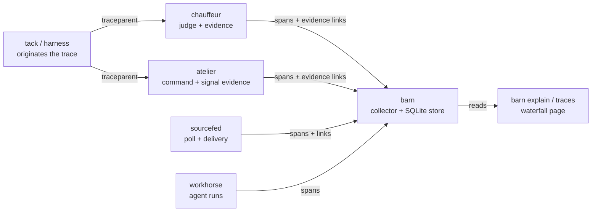
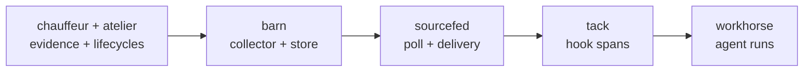

# o11y

Ask what was going on at 14:11 and get one answer. o11y gives every agent
session, monitor, stall and navigation one trace id, and puts their spans,
log lines, metrics and hash-chained evidence in one local store. A chauffeur
judgement, an atelier signal, a sourcefed poll and a barn restart join in the
same trace: one reader walks from a hook to the decision it caused to the
network call that settled it.



## Design

One trace id crosses every module. The agent side — tack or the harness
plugin — originates the trace from its session; daemons accept a
`traceparent` and never invent a session id. An asynchronous hop is a link
between traces, not a parent: a poll that produces an event minutes later
links to the trace that consumes it. A `traceparent` is data, never a
capability, so it changes no judgement, grant or rule.

Every module emits the same envelope: one JSON object per line, with `kind`
of `span`, `log` or `metric`, W3C-compatible trace and span ids, a name like
`chauffeur.judge`, typed bounded attributes and a reference to an evidence
record where one exists. HTTP carries `traceparent` and `tracestate` headers,
Unix-socket JSON-RPC carries them in `_meta`, agent-launched CLIs carry
`TRACEPARENT`, and a missing carrier falls back to joining on session,
monitor, project and stall ids.

Evidence is separate from telemetry. Each module appends its decisions and
signals to its own hash-chained file: each record names the previous
record's hash, and `o11y evidence verify <file>` names the first sequence
that was truncated, edited or reordered. A rotated segment names the
previous file's last hash, so a rotated set is still one chain. A trace
links to a record; the record never depends on the trace. Telemetry is
best-effort: a bounded ring per process drops what the collector cannot take
and reports the count in `barn status`, while evidence still writes and
verifies with barn down.

barn owns the store, a local SQLite file the owner can grep and delete,
bounded by bytes and age. `barn explain` and the `barn traces` commands are
the first reader, with a local waterfall page on the stall's listener. barn
stamps the attributes only it knows on every record: stall, listener, peer,
grant, secret spend, sandbox denial and upgrade.

Instrumentation lands in this order, each module adding a slice to its own
plan:



| Step | Module             | Contribution                                                 |
| ---- | ------------------ | ------------------------------------------------------------ |
| 1    | chauffeur, atelier | evidence and log lines through the SDK, spans for lifecycles |
| 2    | barn               | the collector, the store and stall-only attributes           |
| 3    | sourcefed          | poll, provider, delivery and redelivery spans                |
| 4    | tack               | one hook span per plugin in the chain                        |
| 5    | workhorse          | agent runs, tool use and approvals                           |

Every instrumented module proves its span shape and its redaction in CI:
records carry hashes, lengths and ids, never prompt text, model output,
file bodies, secret values, `Authorization` headers or credentialed URLs.
The SDK has no OpenTelemetry dependency — its envelope has an OTLP mapping —
and adds no production dependency beyond barn's `rusqlite`.

## Install

o11y is not published to a registry. Pin a source checkout to a commit; the
Rust crate needs Rust 1.100 or later.

```sh
git clone https://github.com/wrkhse/o11y.git ~/o11y
cd ~/o11y
git checkout <commit>
```

The Rust crate is at `crates/o11y`; the npm package `@wrkhse/o11y` is at
`packages/o11y`. barn installs the reader that queries the store.

## Ask about a session

One query prints the session as one line per step, in causal order:

```text
14:02:11.418  tack.hook        shell / toolBefore        ok        0.8 ms
14:02:11.419  chauffeur.judge  team/review · atelier     refused   412 ms  ev #41
14:02:11.420  chauffeur.event  verdict withheld          refused
14:02:11.419  barn.broker      api.anthropic.com 200     ok        411 ms
```

The refused judgement carries the id of its evidence record, so the write
shows up in the trace and the record never stands on its own.

## Follow a decision

A navigation, its judgements and the settle form one span tree. The refused
judgement links to the evidence line that recorded it, so the reason and the
record sit side by side. A cancelled call shows where cancellation landed;
a signal that was never sent is recorded as such.

## Check the evidence

The verifier walks a module's chain and names the first bad sequence. A
truncated tail, an edited body or a reordered record fails at that sequence
and nowhere else. A rotated segment keeps the chain: its header names the
previous file's last hash.

## Roadmap

- [ ] Cross-language vectors and `o11y evidence verify` (O0)
- [ ] barn's collector, store, reader CLI and waterfall page (O1)
- [ ] chauffeur and atelier spans and chained evidence (O2, O3)
- [ ] sourcefed, tack and workhorse instrumentation (O4–O6)
- [ ] An end-to-end session walk and a redaction audit (O7)

## More

- [The planned O0 design](https://github.com/wrkhse/o11y/issues/1#issuecomment-7016127609)
- [The plan, wrkhse/o11y#1](https://github.com/wrkhse/o11y/issues/1):
  decisions, the envelope, the evidence format and open questions
- [The record envelope](https://github.com/wrkhse/o11y/issues/1#the-record-envelope)
- [Evidence: one append-only format](https://github.com/wrkhse/o11y/issues/1#evidence-one-append-only-format)
- [Who adopts it, and in what order](https://github.com/wrkhse/o11y/issues/1#who-adopts-it-and-in-what-order)
